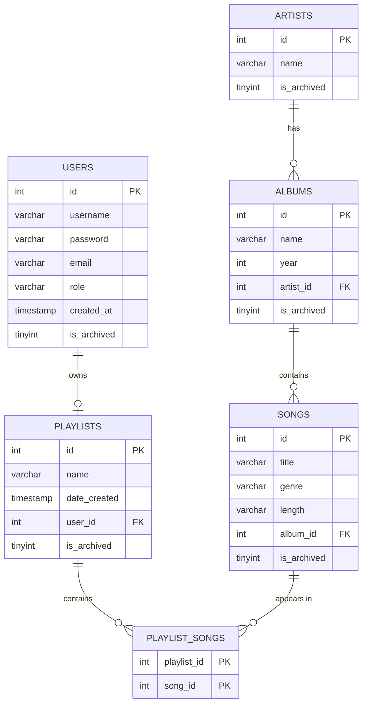

# 🎵 Recording Studio Console App

A Java console application for managing a recording studio's catalog of **artists, albums, songs, users, and playlists**. Built with **JDBC and MySQL (MariaDB)** using a **3-tier architecture** (View → Service → Repository), with **role-based access control** for `ADMIN` and `USER` accounts.

---

## Table of Contents

- [Features](#features)
- [Tech Stack](#tech-stack)
- [Architecture](#architecture)
- [Project Structure](#project-structure)
- [Database Design](#database-design)
- [Use Cases](#use-cases)
- [Getting Started](#getting-started)
- [Running the App](#running-the-app)
- [Sample Usage](#sample-usage)
- [Design Decisions](#design-decisions)
- [Learning Path (3-Day Plan)](#learning-path-3-day-plan)
- [Troubleshooting](#troubleshooting)
- [Author](#author)

---

## Features

- **Full CRUD** for Artists, Albums, Songs, Users, and Playlists
- **Soft delete (archive / restore)** for every module using the `is_archived` column
  - Restore always shows the archived list first, and returns early if there is nothing to restore
- **Search** by keyword (Artists, Albums, Songs, Users, Playlists)
- **Login and registration** with **BCrypt** password hashing
- **Role-based access control (RBAC)**:
  - `ADMIN`: Manage Artists, Albums, Songs, and Users
  - `USER`: Browse Artists, Albums, and Songs, Search Songs, and manage their own playlist
- **One playlist per user** (enforced in the service layer)
- **Many-to-many playlists**: add and remove songs through the `playlist_songs` junction table
- **Console UX**:
  - Bordered, aligned tables with fixed column widths and `...` truncation for long text
  - Screen clearing between menus and a "Press Enter to continue..." pause after each action
  - Press **Enter to keep the current value** when updating an artist
  - The list is re-displayed after every create, update, archive, restore, or delete
- **Input safety**: letters or blank input in a number prompt never crash the app
- **SQL injection safe**: every query with user input uses `PreparedStatement`

---

## Tech Stack

| Area | Technology |
|---|---|
| Language | Java 21 |
| Database | MySQL / MariaDB 10.4 (XAMPP) |
| Data access | JDBC (`PreparedStatement`, try-with-resources) |
| Build tool | Maven |
| JDBC driver | `com.mysql:mysql-connector-j` 9.7.0 |
| Password hashing | jBCrypt (`org.mindrot:jbcrypt` 0.4) |
| IDE | IntelliJ IDEA |

---

## Architecture

The app follows a **3-tier architecture** with a one-way flow:

```
┌──────────────────────┐
│  Presentation Tier   │   view/  : menus, input (ConsoleInput), tables
└──────────┬───────────┘
           │ calls
┌──────────▼───────────┐
│     Service Tier     │   service/ : validation and business rules
└──────────┬───────────┘
           │ calls
┌──────────▼───────────┐
│   Data Access Tier   │   repository/ : JDBC and SQL only
└──────────┬───────────┘
           │
       ┌───▼───┐
       │ MySQL │
       └───────┘
```

| Tier | Responsibility | Must **not** |
|---|---|---|
| **View** | Show menus, read input, display tables and messages | Contain SQL |
| **Service** | Guard clauses (blank strings, IDs `> 0`, year range, email, password length), BCrypt hashing and checking | Read input or run SQL |
| **Repository** | Run SQL through JDBC, map rows to model objects | Validate business rules |

The **model** package (plain Java objects) and the **config** package (database connection) are shared by all tiers.

### Wiring (bottom-up)

All dependencies are created once in `App` and passed through constructors:

```
DbConnection → RepositoryImpl → ServiceImpl → View → App
```

### Data flow

```
Request:  User → View → Service → Repository → Database
Response: Database → Repository → Service → View → User
```

---

## Project Structure

```
recording-app
├── pom.xml
├── database
│   └── recording_studio_db.sql
└── src/main/java/com/joysistvi/recordingapp
    ├── App.java                         # Entry point: wiring, login, role-based dashboards
    ├── config
    │   └── DbConnection.java            # Database connection settings
    ├── model
    │   ├── Artist.java
    │   ├── Album.java
    │   ├── Song.java
    │   ├── Playlist.java
    │   └── User.java
    ├── view                             # Presentation tier
    │   ├── ConsoleInput.java            # Shared input, table, and screen helpers
    │   ├── ArtistView.java
    │   ├── AlbumView.java
    │   ├── SongView.java
    │   ├── PlaylistView.java
    │   └── UserView.java
    ├── service                          # Service tier (interface + implementation)
    │   ├── ArtistService.java / ArtistServiceImpl.java
    │   ├── AlbumService.java  / AlbumServiceImpl.java
    │   ├── SongService.java   / SongServiceImpl.java
    │   ├── PlaylistService.java / PlaylistServiceImpl.java
    │   └── UserService.java   / UserServiceImpl.java
    └── repository                       # Data access tier (interface + implementation)
        ├── ArtistRepository.java / ArtistRepositoryImpl.java
        ├── AlbumRepository.java  / AlbumRepositoryImpl.java
        ├── SongRepository.java   / SongRepositoryImpl.java
        ├── PlaylistRepository.java / PlaylistRepositoryImpl.java
        └── UserRepository.java   / UserRepositoryImpl.java
```

---

## Database Design

**Database name:** `recording_studio_db`
**Schema file:** [`database/recording_studio_db.sql`](database/recording_studio_db.sql) (tables and sample data)

### Entity relationships

- An **Artist** has many **Albums**
- An **Album** has many **Songs**
- A **User** has one **Playlist**
- A **Playlist** has many **Songs**, and a **Song** can be in many playlists (many-to-many through `playlist_songs`)



### Tables

| Table | Columns |
|---|---|
| `artists` | `id`, `name`, `is_archived` |
| `albums` | `id`, `name`, `year`, `artist_id` (FK), `is_archived` |
| `songs` | `id`, `title`, `genre`, `length` (text, e.g. `3:45`), `album_id` (FK), `is_archived` |
| `users` | `id`, `username` (unique), `password` (BCrypt hash), `email` (unique), `role` (`USER` or `ADMIN`, default `USER`), `created_at`, `is_archived` |
| `playlists` | `id`, `name`, `date_created`, `user_id` (FK), `is_archived` |
| `playlist_songs` | `playlist_id` (FK), `song_id` (FK), composite primary key |

---

## Use Cases

**Both actors:** Login

**User:**
- Register Account
- Browse Artists, Albums, and Songs
- Search Songs
- Manage Own Playlist (view, create, delete)
- Add / Remove Songs in Playlist

**Admin:**
- Manage Artists
- Manage Albums
- Manage Songs
- Manage Users

> Self-registration always creates an account with role `USER`. Admin accounts are promoted manually in the database (see below).

---

## Getting Started

### Prerequisites

- **JDK 21**
- **XAMPP** (MySQL / MariaDB) or MySQL 8.x running on port `3306`
- **Maven** (bundled with IntelliJ IDEA)
- Git

### 1. Clone the repository

```bash
git clone https://github.com/Kim-Tiel/recording-app.git
cd recording-app
```

### 2. Create the database

**Option A: phpMyAdmin**
1. Start **Apache** and **MySQL** in XAMPP.
2. Open `http://localhost/phpmyadmin`, then go to **Import**.
3. Choose `database/recording_studio_db.sql` and click **Import**.

**Option B: Terminal**

```bash
mysql -u root < database/recording_studio_db.sql
```

The script creates the `recording_studio_db` database, all tables, and sample artists, albums, songs, users, and playlists.

### 3. Configure the connection

Open `src/main/java/com/joysistvi/recordingapp/config/DbConnection.java` and check the credentials:

```java
private final static String URL = "jdbc:mysql://localhost:3306/recording_studio_db";
private final static String USERNAME = "root";
private final static String PASSWORD = "";
```

### 4. Create an admin account

1. Run the app and **Register** a normal account.
2. Promote it in MySQL:

```sql
UPDATE users SET role = 'ADMIN' WHERE username = 'your_username';
```

> The sample `admin` row in the SQL file uses an old non-BCrypt hash, so register a new account and promote it to log in as an admin.

---

## Running the App

### From IntelliJ IDEA

1. Open the project and let Maven load the dependencies.
2. Run `App.java`.
3. To make screen clearing work, go to **Run → Edit Configurations → App → Modify options** and enable **Emulate terminal in output console**.

---

## Sample Usage

```
=== RECORDING STUDIO ===
1. Login
2. Register
0. Exit
Choice: 1

----- Login -----
Enter username: kimtiel
Enter password: ******

Login successful! Welcome, kimtiel (Role: USER)

=== USER DASHBOARD ===
1. Browse Artists
2. Browse Albums
3. Browse Songs
4. Search Songs
5. My Playlist
0. Logout
Choice: 3

----- Songs -----
+-------+---------------------------+-----------------+----------+------------------------+
| ID    | Title                     | Genre           | Length   | Album                  |
+-------+---------------------------+-----------------+----------+------------------------+
| 1     | Pagtingin                 | Folk Pop        | 4:18     | Limasawa Street        |
| 4     | Ang Huling El Bimbo       | Pinoy Rock      | 7:28     | Cutterpillow           |
| 8     | Your Song (My One and ... | Pinoy Rock      | 4:22     | Bigotilyo              |
+-------+---------------------------+-----------------+----------+------------------------+

Press Enter to continue...
```

Admin view after logging in with an `ADMIN` account:

```
=== ADMIN DASHBOARD ===
1. Manage Artists
2. Manage Albums
3. Manage Songs
4. Manage Users
0. Logout
Choice: 1

=== ARTIST MANAGEMENT ===
1. View All Active Artists
2. Create Artist
3. Update Artist
4. Search Artists
5. Archive Artist (Soft Delete)
6. Restore Archived Artist
7. Delete Artist (Permanent)
0. Back
```

---

## Design Decisions

- **Role stored as `VARCHAR`** (`USER` or `ADMIN`) to keep the role check simple: `"ADMIN".equalsIgnoreCase(user.getRole())`.
- **Soft delete for every module** (`is_archived`) so records can be restored instead of being lost.
- **BCrypt for passwords**: plain-text passwords are never stored. Hashing and checking happen only in `UserServiceImpl`.
- **Validation lives in the Service tier**: guard clauses reject blank text, IDs `<= 0`, out-of-range years, invalid emails, and short passwords before the repository is called.
- **`ConsoleInput` helper** keeps all `Scanner` input, number parsing, table borders, truncation, and screen clearing in one place (DRY), so `App` has no `Scanner`.
- **Invalid numbers return `-1`**: the service rejects it, so the app never crashes on letters or blank input.
- **Deleting a playlist** first removes its rows in `playlist_songs`, then the playlist, inside one transaction.
- **Interfaces for services and repositories** so implementations can be swapped.
- **Song `length` stored as text** (for example, `3:45`) for simplicity.

---

## Learning Path (3-Day Plan)

| Day | Topic | Activity |
|---|---|---|
| **1** | JDBC fundamentals: everything inside one `Main` class (connect, CRUD with `PreparedStatement`) | Artists, Albums, and Users CRUD with guard clauses and BCrypt |
| **2** | 3-tier architecture: refactor `Main` into View, Service, and Repository tiers with constructor injection | Refactor Artist, Album, and User; add the Song module and `handleMenu()` in every view |
| **3** | Complete the application: Playlists, the `playlist_songs` junction table, login, and role-based dashboards | Integrate all modules, polish tables and screen clearing, add the SQL file and README |

---

## Troubleshooting

| Problem | Fix |
|---|---|
| `Communications link failure` | Start MySQL in XAMPP and make sure it runs on port `3306` |
| `Unknown database 'recording_studio_db'` | Import `database/recording_studio_db.sql` first |
| `Access denied for user 'root'` | Check `USERNAME` and `PASSWORD` in `DbConnection.java` |
| `Unknown column 'is_archived'` | Re-import the SQL file so every table has the `is_archived` column |
| Login always fails for an old account | Old accounts may use a non-BCrypt hash. Register a new account instead |
| Screen does not clear / shows `[H[2J` | Enable **Emulate terminal in output console** in the Run Configuration |
| `Cannot delete or update a parent row` | The record is still used by another table (for example, an artist that still has albums). Archive it instead |

---

## Author

**Kim Tiel**
TESDA TWSP Programming (Java) NC III, Joysis Tech Voc Inc.
